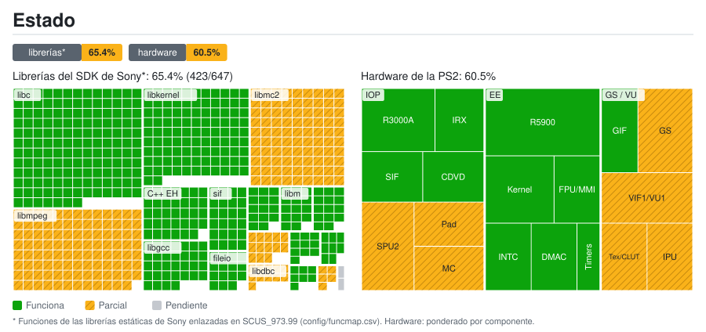
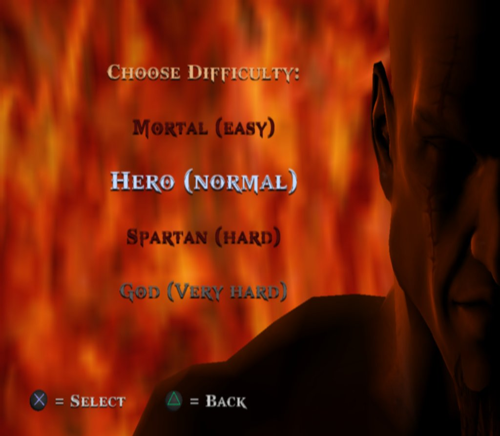
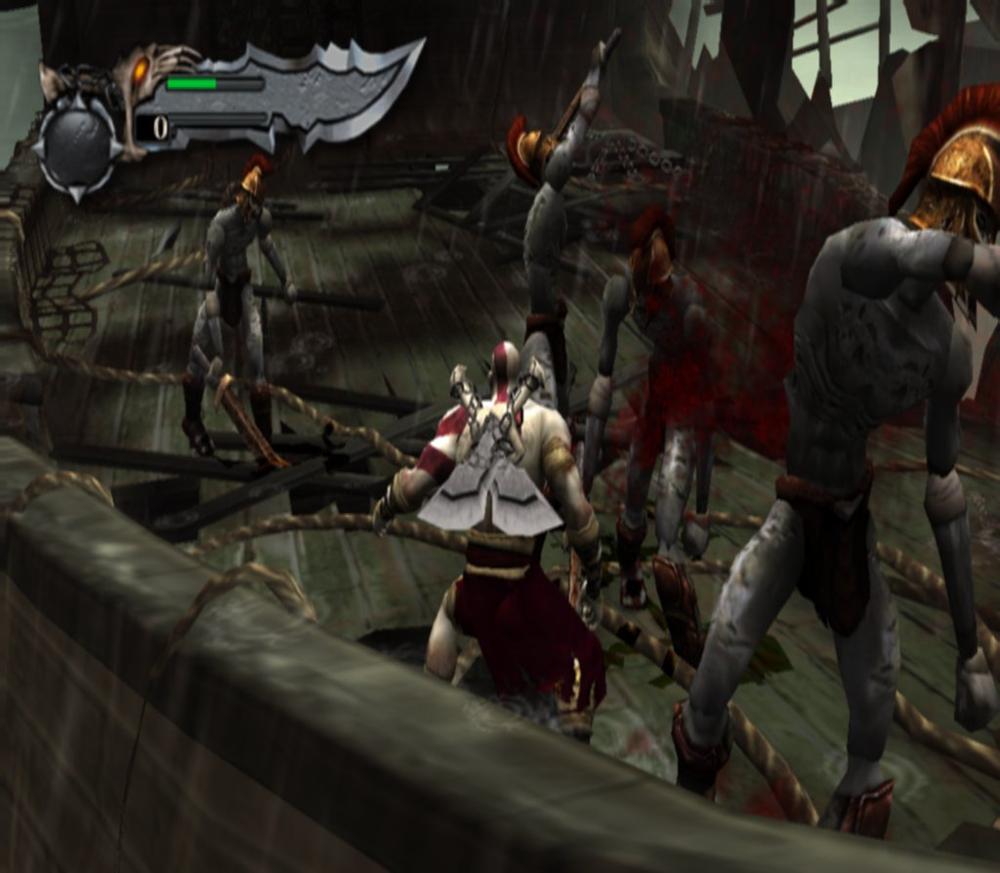
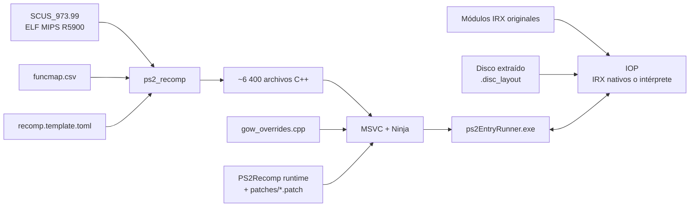

<div align="center">

# God of War — PS2 Static Recompilation

[English](README.md) · **Español** · [Português (Brasil)](README.pt-BR.md)

**Port nativo para PC de *God of War* (PS2, NTSC-U `SCUS-97399`) mediante recompilación estática de MIPS R5900 a C++.**


[](https://github.com/KIexster/god-of-war-recomp/actions/workflows/pruebas.yml)

</div>

---

> [!IMPORTANT]
> Este repositorio **no contiene ningún archivo del juego** (ISO, ejecutable, módulos IRX ni datos `.PAK`)
> ni el código C++ generado a partir de él. Necesitas **tu propia copia legal** de God of War para PS2.

## Índice

- [Qué es](#qué-es)
- [Estado actual](#estado-actual)
- [Estructura del repositorio](#estructura-del-repositorio)
- [Requisitos](#requisitos)
- [Compilar y ejecutar](#compilar-y-ejecutar)
- [Cómo funciona](#cómo-funciona)
- [Documentación](#documentación)
- [Créditos y licencia](#créditos-y-licencia)

## Qué es

En lugar de emular la PlayStation 2, este proyecto **traduce el ejecutable original del juego (`SCUS_973.99`) a
código C++** con [PS2Recomp](https://github.com/ran-j/PS2Recomp) y lo compila como un programa nativo de Windows.
Desde octubre de 2026 la base es el runtime del port nativo de
[**Waffle565**](https://github.com/Waffle565/God-Of-War-Native-Port), que sustituye cada pieza del
hardware de la PS2 por código nativo que produce el mismo resultado a partir de los datos del propio juego:

| Capa | Sustituto nativo |
|---|---|
| **CPU EE** (código del juego) | Recompilación estática a C++ (6 414 funciones) |
| **VU1** (microcódigo vectorial) | Microprogramas compilados por adelantado a C++ |
| **GS** (gráficos) | Renderizador OpenGL por render targets, resolución interna 2x; almacén de texturas/CLUT en lugar de un modelo de VRAM |
| **IOP** (CPU de E/S) | Los 8 módulos IRX del juego compilados por adelantado a C++ (opcional) |
| **Sonido** (SPU2) | Motor de sonido nativo guiado por las llamadas LIBSD del juego |
| **Mando / memory card** | Servicios nativos, sin modelo del SIO2 |
| **DMA / VIF / GIF** | Los paquetes del juego van directos a la VU1 y al GS, sin modelo del controlador DMA |
| **Disco** | Archivos extraídos del disco, cada uno en su sector original (no se lee la ISO) |

Este repositorio contiene todo lo específico de God of War:

| Componente | Descripción |
|---|---|
| **Mapa de funciones** | 6 414 funciones identificadas en el ELF (`config/funcmap.csv`) |
| **Configuración del recompilador** | Stubs, puntos de entrada (incluidos métodos virtuales a los que solo se llega por vtable) y parches de instrucciones (`config/recomp.template.toml`) |
| **Overrides del juego** | Reemplazos y diagnósticos de funciones del juego (`src/gow_overrides.cpp`) |
| **Parches del runtime** | El runtime de Waffle565 y nuestros arreglos encima, un parche por tema (`patches/`) |
| **Scripts de compilación** | Pipeline completo y reproducible en Windows (`scripts/`) |
| **Herramientas** | Extractor del disco, generadores de la VU1 y del IOP nativos, CI y mapa de estado (`tools/`) |

## Estado actual

<a href="docs/estado/detalle.es.md"></a>

Desglose por librería y por componente: [`docs/estado/detalle.es.md`](docs/estado/detalle.es.md). Se regenera a partir de `docs/estado/datos.toml` con `tools/estado/generar.py` (y automáticamente al subir a `main`).

Compilación nativa para Windows en un Ryzen 7 5800XT con una RX 5700 XT (capturas del GS a 1024×894):

<p align="center">
  
  
</p>

| Hito | Estado |
|---|:---:|
| Recompilación de `SCUS_973.99` a C++ y ejecutable nativo (MSVC, x64) | ✅ |
| Datos leídos de los archivos del disco extraído, sin la ISO | ✅ |
| Arranque, menús, partida nueva y combate en el barco, con HUD | ✅ |
| VU1 nativa (todos los bloques del barco sin intérprete) | ✅ |
| IOP nativo: los 8 IRX compilados (partida a ~21 s en lugar de ~34 s) | ✅ |
| Velocidad del juego exacta (1,00) | ✅ |
| Suite del runtime en Windows (MSVC) y Linux (GCC) | ✅ |
| 60 fps en el barco con la cámara quieta: ~53–56 llamadas a `vid::Flip` por segundo de mediana | 🔧 en progreso |
| Zonas guardadas, guardar/cargar y vídeos con sonido: verificados por Waffle565, por repetir aquí | 🔧 en progreso |
| Recorrido completo del juego | ⏳ pendiente |
| Idiomas PAL y lanzador con selector | ⏳ aparcado |

El juego se juega como el port de Waffle565: arranca, carga sus datos del disco extraído y llega a la partida con
teclado o mando. El rendimiento en escenas cargadas todavía no llega a 60 en esta máquina; el camino crítico de cada
cuadro es el trabajo de VU1 y GS (~11–13 ms). Hay un cuelgue intermitente del hilo de la ventana (el juego sigue
corriendo) que se está investigando. Ver [`docs/ESTADO.md`](docs/ESTADO.md) para las mediciones y sus límites.

## Estructura del repositorio

```
.
├── .github/workflows/            # CI: pruebas (pruebas.yml) y mapa de estado (estado.yml)
├── AGENTS.md                     # Convenciones del proyecto para colaboradores y agentes
├── config/
│   ├── funcmap.csv               # Mapa de funciones (nombre, inicio, fin, tamaño)
│   └── recomp.template.toml      # Configuración de PS2Recomp (@ELF@, @MAP@, @OUT@)
├── docs/                         # Documentación técnica
│   ├── capturas/                 # Capturas de esta página
│   └── estado/                   # Datos del mapa de estado y SVG/tablas generados
├── game/                         # Aquí va TU disco extraído: SCUS_973.99, IRX, PAK, .disc_layout (ignorado por git)
├── patches/
│   ├── ps2recomp-waffle-runtime.patch   # Runtime de Waffle565 sobre PS2Recomp @ c5a9d02
│   ├── ps2recomp-*.patch         # Nuestros arreglos encima, en el orden de scripts/compilar.ps1
│   └── anteriores/               # Pila de parches anterior a la migración (referencia, no se aplica)
├── scripts/
│   ├── 1_instalar_herramientas.cmd
│   ├── 2_compilar.cmd            # Pipeline completo (GOW_IOP_MODULOS: IOP nativo)
│   ├── 2_recompilar_rapido.cmd   # Recompila solo src/gow_overrides.cpp (~1 min)
│   ├── 3_ejecutar.cmd            # Ejecuta 60 s y guarda logs (extrae el disco la primera vez)
│   ├── 3_ejecutar_manual.cmd     # Ejecuta sin límite de tiempo
│   ├── probar_menu.ps1           # Prueba del menú con capturas del GS
│   ├── probar_pad2.cmd           # Compila y ejecuta la prueba de paquetes de libpad2
│   └── *.ps1                     # Lógica de los scripts
├── src/
│   ├── gow_overrides.cpp         # Overrides específicos del juego (de Waffle565)
│   └── *.h                       # Formatos y ayudas probados (paquete de libpad2, replay GS…)
├── tests/                        # Pruebas independientes del juego y fallos conocidos de la suite
└── tools/
    ├── ci/                       # Ayudas de la CI (orden de parches, config, pruebas)
    ├── estado/generar.py         # Generador del mapa de estado
    ├── iop/iopn_gen.py           # Compila los IRX del juego a C++ (IOP nativo)
    ├── vu1/vu1n_gen.py           # Compila el microcódigo de VU1 a C++ (VU1 nativa)
    └── iso_extract.py            # Extrae el disco con sus sectores originales (--layout)
```

## Requisitos

- Windows 10/11 x64
- [Visual Studio 2022 Build Tools](https://visualstudio.microsoft.com/downloads/) con la carga de trabajo **C++** (incluye CMake y Ninja)
- [Git](https://git-scm.com/)
- [Python 3](https://www.python.org/) (extracción del disco y generadores de la VU1 y el IOP nativos)
- ~20 GB libres (el disco extraído ocupa ~8,5 GB) y 16 GB de RAM recomendados (la compilación usa todos los núcleos)
- Una copia propia de **God of War (NTSC-U, SCUS-97399)**

`scripts\1_instalar_herramientas.cmd` instala Git y las Build Tools con `winget`.

## Compilar y ejecutar

**1. Extrae el disco.** Como en el port de Waffle565, el juego lee sus datos de los archivos del disco
extraídos, cada uno en su sector original (sin leer la ISO). Con Python 3:

```bat
python tools\iso_extract.py "D:\God of War.iso" game --layout
```

Eso deja en `game\` el ejecutable `SCUS_973.99`, los módulos `.IRX`, `PART1.PAK`/`PART2.PAK` (las dos capas del
DVD) y el índice `.disc_layout`. Si el ELF está en otra carpeta, define `GOW_ELF` con su ruta; los archivos del
disco deben estar junto a él. `scripts\ejecutar.ps1` extrae el disco por su cuenta la primera vez si encuentra
`God of War.iso` en la carpeta superior a la del ELF, y `GOW_ISO=<ruta>` hace que se lea la imagen directamente.

**2. Instala las herramientas** (solo la primera vez):

```bat
scripts\1_instalar_herramientas.cmd
```

**3. Compila** (20–40 min la primera vez):

```bat
scripts\2_compilar.cmd
```

El script clona PS2Recomp en `<unidad>:\gowport` (ruta corta para esquivar el límite de 260 caracteres;
configurable con `GOW_WORK`), fija el commit `c5a9d02`, aplica los parches de `patches/`, genera el C++ y compila
`ps2EntryRunner.exe`. El registro queda en `logs\2_compilar.log`.

Las compilaciones Release desactivan por defecto las trazas de funciones y RPC del IOP. Para
investigar, usa `scripts\2_compilar.cmd -Trazas`. Para medir las llamadas a `vid::Flip` del juego
por separado del refresco de la ventana, ejecuta `powershell -File scripts\probar_rendimiento.ps1`;
consulta [las notas del perfil](docs/ESTADO.md#medicion-de-rendimiento-2026-10-05).

**4. Ejecuta:**

```bat
scripts\3_ejecutar.cmd          :: 60 segundos, salida en logs\
scripts\3_ejecutar_manual.cmd   :: sin límite
```

**F2** muestra un medidor de FPS (también con `GOW_FPS=1`); ver [`docs/CONTROLES.md`](docs/CONTROLES.md#medidor-de-fps).
El juego empieza en pantalla completa sin bordes; **F11** cambia a ventana y vuelve (`GOW_PANTALLA_COMPLETA=0` empieza
en ventana). **F1** abre el depurador del runtime.
`GOW_PANORAMICO=ampliado` usa el panorámico ampliado (vista más ancha en lugar de recortada arriba y abajo, idea de
nemesis2000 y CRASHARKI); dibuja más y cuesta rendimiento.
`GOW_HZ=120` (experimental) hace que la lógica del juego pueda ir a más de 60 cuadros por segundo (hasta 120, según la
escena y el equipo) y presenta hasta 120 imágenes por segundo; ver [`docs/CONTROLES.md`](docs/CONTROLES.md#120-hz).

**5. IOP nativo (opcional, como en el port de Waffle565).** Compila por adelantado los 8 módulos IRX del juego
y acorta la carga (la partida empieza a ~21 s en lugar de ~34 s). Una ejecución vuelca los módulos y la
siguiente compilación los usa:

```bat
set PS2X_IOP_DUMP_MODULES=%CD%\logs\iop_modulos
scripts\3_ejecutar.cmd
set PS2X_IOP_DUMP_MODULES=
set GOW_IOP_MODULOS=%CD%\logs\iop_modulos
scripts\2_compilar.cmd
```

## Cómo funciona



Más detalles en [`docs/ARQUITECTURA.md`](docs/ARQUITECTURA.md).

## Documentación

- [`docs/ARQUITECTURA.md`](docs/ARQUITECTURA.md) — pipeline, overrides, parches del runtime e integración continua
- [`docs/CONTROLES.md`](docs/CONTROLES.md) — controles y pruebas del mando y del menú
- [`docs/RENDERIZADO.md`](docs/RENDERIZADO.md) — renderers CPU/CPU con hilo/OpenGL opcionales y comparaciones
- [`docs/RENDIMIENTO.md`](docs/RENDIMIENTO.md) — mediciones de rendimiento, hilos opcionales y optimizaciones de VU1
- [`AGENTS.md`](AGENTS.md) — convenciones del proyecto para colaboradores y agentes
- [`docs/ESTADO.md`](docs/ESTADO.md) — estado actual, registro de la investigación, problemas conocidos y próximos pasos

## Créditos y licencia

- [**PS2Recomp**](https://github.com/ran-j/PS2Recomp) de ran-j y colaboradores — recompilador y runtime (GPL-3.0).
- [**God-Of-War-Native-Port**](https://github.com/Waffle565/God-Of-War-Native-Port) de Waffle565 — runtime nativo (GS, VU1, IOP, sonido, DMA, disco), overrides y herramientas que son la base del port desde octubre de 2026; su port partió a su vez de este repositorio.
- Autores de [**PCSX2**](https://github.com/PCSX2/pcsx2) — GS original utilizado por el módulo de diagnóstico DX11 opcional, y el intérprete del EE y las operaciones de VU del runtime (`ee_ref/`, `vu_pcsx2/`, traídos con el runtime de Waffle565) (GPL-3.0+).
- [**Urban Reign recomp**](https://github.com/thiagordsfx/urban-reign-recomp) de thiagordsfx — referencia compartida de integración GS; ayudó a identificar la convención de campo VSync de nuestro espejo ([revisión y alcance](docs/REVISION_URBAN_REIGN.md)).
- [**Fork del runtime de SotC**](https://github.com/LightVelox/PS2Recomp/tree/ac9efa070638ad3b3accd284de6f898d5ab271d1) de Taylor N. Albarnaz / LightVelox — backend GS OpenGL y cola de comandos, y arreglos del EE (FPU, ramas de 64 bits, LQ/SQ, saltos finales, VU0 en modo macro y cadenas DMA largas) (GPL-3.0, `ac9efa0`).
- *God of War* © Sony Interactive Entertainment / Santa Monica Studio. Este proyecto no está afiliado
  ni respaldado por Sony. No se distribuye ningún contenido del juego.

El código de este repositorio se publica bajo la licencia **GPL-3.0**, en coherencia con PS2Recomp.
Ver [`LICENSE`](LICENSE).
