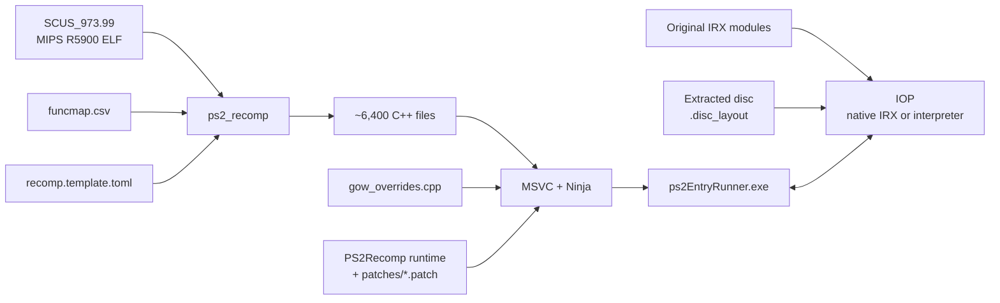

<div align="center">

# God of War — PS2 Static Recompilation

**English** · [Español](README.es.md) · [Português (Brasil)](README.pt-BR.md)

**A native PC port of *God of War* (PS2, NTSC-U `SCUS-97399`) built by statically recompiling MIPS R5900 code to C++.**


[](https://github.com/KIexster/god-of-war-recomp/actions/workflows/pruebas.yml)

</div>

---

> [!IMPORTANT]
> This repository **does not contain any game files** (ISO, executable, IRX modules or `.PAK` data),
> nor the C++ code generated from them. You need **your own legal copy** of God of War for the PS2.

## Contents

- [What is this?](#what-is-this)
- [Current status](#current-status)
- [Repository layout](#repository-layout)
- [Requirements](#requirements)
- [Building and running](#building-and-running)
- [How it works](#how-it-works)
- [Documentation](#documentation)
- [Credits and license](#credits-and-license)

## What is this?

Instead of emulating the PlayStation 2, this project **translates the game's original executable (`SCUS_973.99`)
into C++** with [PS2Recomp](https://github.com/ran-j/PS2Recomp) and compiles it into a native Windows program.
Since October 2026 the base is the runtime of [**Waffle565**](https://github.com/Waffle565/God-Of-War-Native-Port)'s
native port, which replaces every piece of PS2 hardware with native code that produces the
same result from the game's own data:

| Layer | Native replacement |
|---|---|
| **EE CPU** (game code) | Static recompilation to C++ (6,414 functions) |
| **VU1** (vector microcode) | Microprograms compiled ahead of time to C++ |
| **GS** (graphics) | OpenGL render-target renderer, 2x internal resolution; texture/CLUT store instead of a VRAM model |
| **IOP** (I/O CPU) | The game's 8 IRX modules compiled ahead of time to C++ (optional) |
| **Sound** (SPU2) | Native sound engine driven by the game's LIBSD calls |
| **Pad / memory card** | Native services, no SIO2 model |
| **DMA / VIF / GIF** | The game's packets go straight to VU1 and the GS, no DMA controller model |
| **Disc** | Files extracted from the disc, each at its original sector (the ISO is not read) |

This repository contains everything specific to God of War:

| Component | Description |
|---|---|
| **Function map** | 6,414 functions identified in the ELF (`config/funcmap.csv`) |
| **Recompiler configuration** | Stubs, entry points (including virtual methods reachable only through a vtable) and instruction patches (`config/recomp.template.toml`) |
| **Game overrides** | Replacements and diagnostics for game functions (`src/gow_overrides.cpp`) |
| **Runtime patches** | Waffle565's runtime and our fixes on top, one patch per topic (`patches/`) |
| **Build scripts** | Complete, reproducible pipeline on Windows (`scripts/`) |
| **Tools** | Disc extractor, native VU1 and IOP generators, CI and status map (`tools/`) |

## Current status

<a href="docs/estado/detalle.en.md"></a>

Per-library and per-component breakdown: [`docs/estado/detalle.en.md`](docs/estado/detalle.en.md). Regenerated from `docs/estado/datos.toml` by `tools/estado/generar.py` (and automatically on push to `main`).

Native Windows build on a Ryzen 7 5800XT with an RX 5700 XT (GS captures at 1024×894):

<p align="center">
  
  
</p>

| Milestone | Status |
|---|:---:|
| `SCUS_973.99` recompiled to C++ and native executable (MSVC, x64) | ✅ |
| Data read from the extracted disc files, no ISO | ✅ |
| Boot, menus, new game and the ship fight, with HUD | ✅ |
| Native VU1 (every block on the ship without the interpreter) | ✅ |
| Native IOP: the 8 IRX compiled (gameplay at ~21 s instead of ~34 s) | ✅ |
| Exact game speed (1.00) | ✅ |
| Runtime test suite on Windows (MSVC) and Linux (GCC) | ✅ |
| 60 fps on the ship with the camera still: median ~53–56 `vid::Flip` calls per second | 🔧 in progress |
| Saved zones, save/load and movies with sound: verified by Waffle565, to be repeated here | 🔧 in progress |
| Full playthrough | ⏳ pending |
| PAL languages and launcher with a selector | ⏳ on hold |

The game plays like Waffle565's port: it boots, loads its data from the extracted disc and reaches gameplay with
keyboard or controller. Performance in heavy scenes does not reach 60 on this machine yet; the critical path of each
frame is the VU1 and GS work (~11–13 ms). An intermittent hang of the window thread (the game keeps running) is
being investigated. See [`docs/ESTADO.md`](docs/ESTADO.md) for the measurements and their limits.

## Repository layout

```
.
├── .github/workflows/            # CI: tests (pruebas.yml) and status map (estado.yml)
├── AGENTS.md                     # Project conventions for contributors and agents
├── config/
│   ├── funcmap.csv               # Function map (name, start, end, size)
│   └── recomp.template.toml      # PS2Recomp configuration (@ELF@, @MAP@, @OUT@)
├── docs/                         # Technical documentation
│   ├── capturas/                 # Screenshots for this page
│   └── estado/                   # Status map data and generated SVG/tables
├── game/                         # YOUR extracted disc goes here: SCUS_973.99, IRX, PAK, .disc_layout (git-ignored)
├── patches/
│   ├── ps2recomp-waffle-runtime.patch   # Waffle565's runtime on PS2Recomp @ c5a9d02
│   ├── ps2recomp-*.patch         # Our fixes on top, in scripts/compilar.ps1 order
│   └── anteriores/               # Patch stack from before the migration (reference, not applied)
├── scripts/
│   ├── 1_instalar_herramientas.cmd
│   ├── 2_compilar.cmd            # Full pipeline (GOW_IOP_MODULOS: native IOP)
│   ├── 2_recompilar_rapido.cmd   # Rebuilds only src/gow_overrides.cpp (~1 min)
│   ├── 3_ejecutar.cmd            # Runs for 60 s and saves logs (extracts the disc the first time)
│   ├── 3_ejecutar_manual.cmd     # Runs with no time limit
│   ├── probar_menu.ps1           # Menu test with GS captures
│   ├── probar_pad2.cmd           # Builds and runs the libpad2 packet test
│   └── *.ps1                     # Script logic
├── src/
│   ├── gow_overrides.cpp         # Game-specific overrides (from Waffle565)
│   └── *.h                       # Tested formats and helpers (libpad2 packet, GS replay…)
├── tests/                        # Game-independent tests and known suite failures
└── tools/
    ├── ci/                       # CI helpers (patch order, config, tests)
    ├── estado/generar.py         # Status map generator
    ├── iop/iopn_gen.py           # Compiles the game's IRX to C++ (native IOP)
    ├── vu1/vu1n_gen.py           # Compiles the VU1 microcode to C++ (native VU1)
    └── iso_extract.py            # Extracts the disc keeping its original sectors (--layout)
```

## Requirements

- Windows 10/11 x64
- [Visual Studio 2022 Build Tools](https://visualstudio.microsoft.com/downloads/) with the **C++** workload (includes CMake and Ninja)
- [Git](https://git-scm.com/)
- [Python 3](https://www.python.org/) (disc extraction and the native VU1/IOP generators)
- ~20 GB of free space (the extracted disc takes ~8.5 GB); 16 GB of RAM recommended (the build uses every core)
- Your own copy of **God of War (NTSC-U, SCUS-97399)**

`scripts\1_instalar_herramientas.cmd` installs Git and the Build Tools with `winget`.

## Building and running

**1. Extract the disc.** As in Waffle565's port, the game reads its data from the extracted disc files,
each at its original sector (the ISO is not read). With Python 3:

```bat
python tools\iso_extract.py "D:\God of War.iso" game --layout
```

This leaves the executable `SCUS_973.99`, the `.IRX` modules, `PART1.PAK`/`PART2.PAK` (both DVD layers) and the
`.disc_layout` index in `game\`. If the ELF is somewhere else, point `GOW_ELF` at it; the disc files must sit next
to it. `scripts\ejecutar.ps1` extracts the disc by itself on first run if it finds `God of War.iso` in the folder
above the ELF's, and `GOW_ISO=<path>` makes the runtime read the image directly.

**2. Install the tools** (first time only):

```bat
scripts\1_instalar_herramientas.cmd
```

**3. Build** (20–40 min the first time):

```bat
scripts\2_compilar.cmd
```

The script clones PS2Recomp into `<drive>:\gowport` (a short path to avoid the 260-character limit;
configurable with `GOW_WORK`), pins commit `c5a9d02`, applies the patches in `patches/`, generates the C++ code and builds
`ps2EntryRunner.exe`. The log is written to `logs\2_compilar.log`.

Release builds disable function and IOP RPC traces by default. For diagnostics, use
`scripts\2_compilar.cmd -Trazas`. To measure game `vid::Flip` calls separately from window refreshes,
run `powershell -File scripts\probar_rendimiento.ps1`; see [the profiling notes](docs/ESTADO.md#medicion-de-rendimiento-2026-10-05).

**4. Run:**

```bat
scripts\3_ejecutar.cmd          :: 60 seconds, output in logs\
scripts\3_ejecutar_manual.cmd   :: no time limit
```

**F2** shows an FPS meter (also with `GOW_FPS=1`); see [`docs/CONTROLES.md`](docs/CONTROLES.md#medidor-de-fps).

**5. Native IOP (optional, as in Waffle565's port).** Compiles the game's 8 IRX modules ahead of time and
shortens loading (gameplay starts at ~21 s instead of ~34 s). One run dumps the modules and the next build
uses them:

```bat
set PS2X_IOP_DUMP_MODULES=%CD%\logs\iop_modulos
scripts\3_ejecutar.cmd
set PS2X_IOP_DUMP_MODULES=
set GOW_IOP_MODULOS=%CD%\logs\iop_modulos
scripts\2_compilar.cmd
```

## How it works



More details in [`docs/ARQUITECTURA.md`](docs/ARQUITECTURA.md).

## Documentation

The technical documentation is currently written in Spanish:

- [`docs/ARQUITECTURA.md`](docs/ARQUITECTURA.md) — pipeline, overrides, runtime patches and CI
- [`docs/CONTROLES.md`](docs/CONTROLES.md) — controls and menu/input tests
- [`docs/RENDERIZADO.md`](docs/RENDERIZADO.md) — optional CPU/threaded CPU/OpenGL renderers and comparisons
- [`docs/RENDIMIENTO.md`](docs/RENDIMIENTO.md) — performance measurements, optional threads and VU1 optimizations
- [`AGENTS.md`](AGENTS.md) — project conventions for contributors and coding agents
- [`docs/ESTADO.md`](docs/ESTADO.md) — current status, investigation log, known issues and next steps

## Credits and license

- [**PS2Recomp**](https://github.com/ran-j/PS2Recomp) by ran-j and contributors — recompiler and runtime (GPL-3.0).
- [**God-Of-War-Native-Port**](https://github.com/Waffle565/God-Of-War-Native-Port) by Waffle565 — native runtime (GS, VU1, IOP, sound, DMA, disc), overrides and tools that are the base of the port since October 2026; their port in turn started from this repository.
- [**PCSX2**](https://github.com/PCSX2/pcsx2) contributors — original GS used by the optional DX11 diagnostic module, and the EE interpreter and VU operations of the runtime (`ee_ref/`, `vu_pcsx2/`, brought in with Waffle565's runtime) (GPL-3.0+).
- [**Urban Reign recomp**](https://github.com/thiagordsfx/urban-reign-recomp) by thiagordsfx — shared GS integration reference; helped identify the VSync field convention in our diagnostic mirror ([review and scope](docs/REVISION_URBAN_REIGN.md)).
- [**SotC runtime fork**](https://github.com/LightVelox/PS2Recomp/tree/ac9efa070638ad3b3accd284de6f898d5ab271d1) by Taylor N. Albarnaz / LightVelox — OpenGL GS backend and command queue, and EE fixes (FPU, 64-bit branches, LQ/SQ, tail jumps, VU0 macro mode and long DMA chains) (GPL-3.0, `ac9efa0`).
- *God of War* © Sony Interactive Entertainment / Santa Monica Studio. This project is not affiliated with
  or endorsed by Sony. No game content is distributed.

The code in this repository is released under the **GPL-3.0** license, consistent with PS2Recomp.
See [`LICENSE`](LICENSE).
