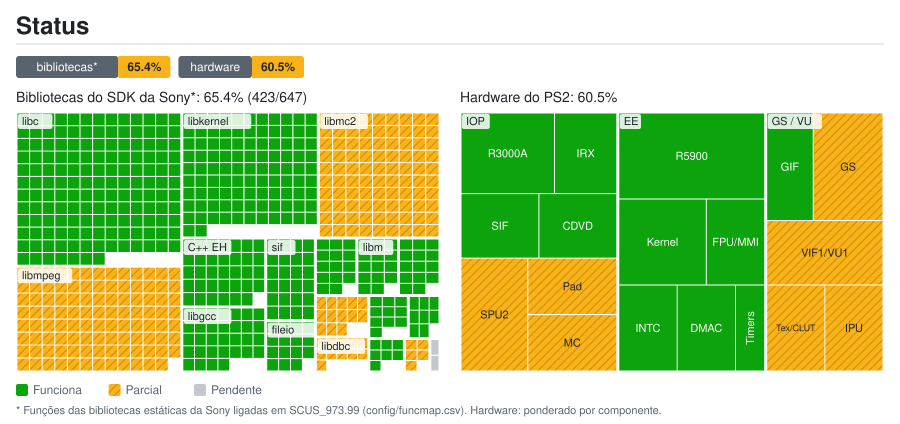
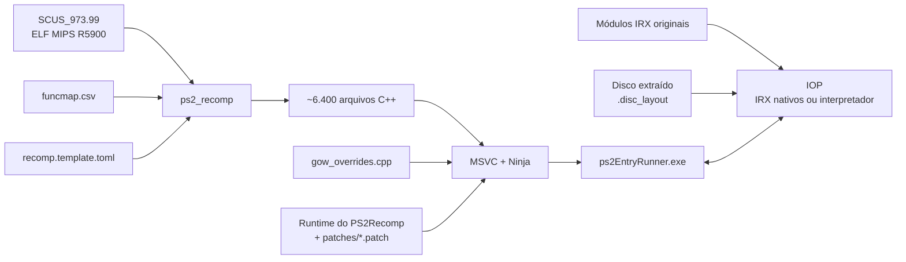

<div align="center">

# God of War — PS2 Static Recompilation

[English](README.md) · [Español](README.es.md) · **Português (Brasil)**

**Port nativo para PC de *God of War* (PS2, NTSC-U `SCUS-97399`) feito por recompilação estática de código MIPS R5900 para C++.**


[](https://github.com/KIexster/god-of-war-recomp/actions/workflows/pruebas.yml)

</div>

---

> [!IMPORTANT]
> Este repositório **não contém nenhum arquivo do jogo** (ISO, executável, módulos IRX ou dados `.PAK`),
> nem o código C++ gerado a partir deles. Você precisa da **sua própria cópia legal** de God of War para PS2.

## Sumário

- [O que é](#o-que-é)
- [Status atual](#status-atual)
- [Estrutura do repositório](#estrutura-do-repositório)
- [Requisitos](#requisitos)
- [Compilar e executar](#compilar-e-executar)
- [Como funciona](#como-funciona)
- [Documentação](#documentação)
- [Créditos e licença](#créditos-e-licença)

## O que é

Em vez de emular o PlayStation 2, este projeto **traduz o executável original do jogo (`SCUS_973.99`) para C++**
com o [PS2Recomp](https://github.com/ran-j/PS2Recomp) e o compila como um programa nativo do Windows. Desde outubro
de 2026 a base é o runtime do port nativo do
[**Waffle565**](https://github.com/Waffle565/God-Of-War-Native-Port), que substitui cada peça
do hardware do PS2 por código nativo que produz o mesmo resultado a partir dos dados do próprio jogo:

| Camada | Substituto nativo |
|---|---|
| **CPU EE** (código do jogo) | Recompilação estática para C++ (6 414 funções) |
| **VU1** (microcódigo vetorial) | Microprogramas compilados antecipadamente para C++ |
| **GS** (gráficos) | Renderizador OpenGL por render targets, resolução interna 2x; armazém de texturas/CLUT em vez de um modelo de VRAM |
| **IOP** (CPU de E/S) | Os 8 módulos IRX do jogo compilados antecipadamente para C++ (opcional) |
| **Som** (SPU2) | Motor de som nativo guiado pelas chamadas LIBSD do jogo |
| **Controle / memory card** | Serviços nativos, sem modelo do SIO2 |
| **DMA / VIF / GIF** | Os pacotes do jogo vão direto para a VU1 e o GS, sem modelo do controlador DMA |
| **Disco** | Arquivos extraídos do disco, cada um no seu setor original (a ISO não é lida) |

Este repositório contém tudo o que é específico de God of War:

| Componente | Descrição |
|---|---|
| **Mapa de funções** | 6 414 funções identificadas no ELF (`config/funcmap.csv`) |
| **Configuração do recompilador** | Stubs, pontos de entrada (incluindo métodos virtuais alcançados apenas via vtable) e patches de instruções (`config/recomp.template.toml`) |
| **Overrides do jogo** | Substituições e diagnósticos de funções do jogo (`src/gow_overrides.cpp`) |
| **Patches do runtime** | O runtime do Waffle565 e nossas correções por cima, um patch por tema (`patches/`) |
| **Scripts de compilação** | Pipeline completo e reprodutível no Windows (`scripts/`) |
| **Ferramentas** | Extrator do disco, geradores da VU1 e do IOP nativos, CI e mapa de status (`tools/`) |

## Status atual

<a href="docs/estado/detalle.pt-BR.md"></a>

Detalhamento por biblioteca e por componente: [`docs/estado/detalle.pt-BR.md`](docs/estado/detalle.pt-BR.md). Regenerado a partir de `docs/estado/datos.toml` por `tools/estado/generar.py` (e automaticamente ao enviar para `main`).

Compilação nativa para Windows em um Ryzen 7 5800XT com uma RX 5700 XT (capturas do GS em 1024×894):

<p align="center">
  
  
</p>

| Marco | Status |
|---|:---:|
| `SCUS_973.99` recompilado para C++ e executável nativo (MSVC, x64) | ✅ |
| Dados lidos dos arquivos do disco extraído, sem a ISO | ✅ |
| Boot, menus, novo jogo e combate no barco, com HUD | ✅ |
| VU1 nativa (todos os blocos do barco sem interpretador) | ✅ |
| IOP nativo: os 8 IRX compilados (partida aos ~21 s em vez de ~34 s) | ✅ |
| Velocidade do jogo exata (1,00) | ✅ |
| Suíte do runtime no Windows (MSVC) e no Linux (GCC) | ✅ |
| 60 fps no barco com a câmera parada: mediana de ~53–56 chamadas a `vid::Flip` por segundo | 🔧 em progresso |
| Zonas salvas, salvar/carregar e vídeos com som: verificados pelo Waffle565, a repetir aqui | 🔧 em progresso |
| Percurso completo do jogo | ⏳ pendente |
| Idiomas PAL e launcher com seletor | ⏳ em espera |

O jogo roda como o port do Waffle565: inicia, carrega seus dados do disco extraído e chega à partida com teclado ou
controle. O desempenho em cenas pesadas ainda não chega a 60 nesta máquina; o caminho crítico de cada quadro é o
trabalho de VU1 e GS (~11–13 ms). Há um travamento intermitente da thread da janela (o jogo continua rodando) em
investigação. Veja [`docs/ESTADO.md`](docs/ESTADO.md) para as medições e seus limites.

## Estrutura do repositório

```
.
├── .github/workflows/            # CI: testes (pruebas.yml) e mapa de status (estado.yml)
├── AGENTS.md                     # Convenções do projeto para colaboradores e agentes
├── config/
│   ├── funcmap.csv               # Mapa de funções (nome, início, fim, tamanho)
│   └── recomp.template.toml      # Configuração do PS2Recomp (@ELF@, @MAP@, @OUT@)
├── docs/                         # Documentação técnica
│   ├── capturas/                 # Capturas desta página
│   └── estado/                   # Dados do mapa de status e SVG/tabelas gerados
├── game/                         # Aqui vai o SEU disco extraído: SCUS_973.99, IRX, PAK, .disc_layout (ignorado pelo git)
├── patches/
│   ├── ps2recomp-waffle-runtime.patch   # Runtime do Waffle565 sobre o PS2Recomp @ c5a9d02
│   ├── ps2recomp-*.patch         # Nossas correções por cima, na ordem de scripts/compilar.ps1
│   └── anteriores/               # Pilha de patches anterior à migração (referência, não é aplicada)
├── scripts/
│   ├── 1_instalar_herramientas.cmd
│   ├── 2_compilar.cmd            # Pipeline completo (GOW_IOP_MODULOS: IOP nativo)
│   ├── 2_recompilar_rapido.cmd   # Recompila apenas src/gow_overrides.cpp (~1 min)
│   ├── 3_ejecutar.cmd            # Executa por 60 s e salva logs (extrai o disco na primeira vez)
│   ├── 3_ejecutar_manual.cmd     # Executa sem limite de tempo
│   ├── probar_menu.ps1           # Teste do menu com capturas do GS
│   ├── probar_pad2.cmd           # Compila e executa o teste de pacotes do libpad2
│   └── *.ps1                     # Lógica dos scripts
├── src/
│   ├── gow_overrides.cpp         # Overrides específicos do jogo (do Waffle565)
│   └── *.h                       # Formatos e auxiliares testados (pacote do libpad2, replay GS…)
├── tests/                        # Testes independentes do jogo e falhas conhecidas da suíte
└── tools/
    ├── ci/                       # Auxiliares da CI (ordem dos patches, config, testes)
    ├── estado/generar.py         # Gerador do mapa de status
    ├── iop/iopn_gen.py           # Compila os IRX do jogo para C++ (IOP nativo)
    ├── vu1/vu1n_gen.py           # Compila o microcódigo da VU1 para C++ (VU1 nativa)
    └── iso_extract.py            # Extrai o disco mantendo os setores originais (--layout)
```

## Requisitos

- Windows 10/11 x64
- [Visual Studio 2022 Build Tools](https://visualstudio.microsoft.com/downloads/) com a carga de trabalho **C++** (inclui CMake e Ninja)
- [Git](https://git-scm.com/)
- [Python 3](https://www.python.org/) (extração do disco e geradores da VU1 e do IOP nativos)
- ~20 GB livres (o disco extraído ocupa ~8,5 GB); 16 GB de RAM recomendados (a compilação usa todos os núcleos)
- Uma cópia própria de **God of War (NTSC-U, SCUS-97399)**

`scripts\1_instalar_herramientas.cmd` instala o Git e as Build Tools com o `winget`.

## Compilar e executar

**1. Extraia o disco.** Como no port do Waffle565, o jogo lê seus dados dos arquivos extraídos do disco,
cada um no seu setor original (a ISO não é lida). Com Python 3:

```bat
python tools\iso_extract.py "D:\God of War.iso" game --layout
```

Isso deixa em `game\` o executável `SCUS_973.99`, os módulos `.IRX`, `PART1.PAK`/`PART2.PAK` (as duas camadas do
DVD) e o índice `.disc_layout`. Se o ELF estiver em outra pasta, aponte `GOW_ELF` para ele; os arquivos do disco
devem ficar ao lado dele. O `scripts\ejecutar.ps1` extrai o disco sozinho na primeira execução se encontrar
`God of War.iso` na pasta acima da do ELF, e `GOW_ISO=<caminho>` faz o runtime ler a imagem diretamente.

**2. Instale as ferramentas** (só na primeira vez):

```bat
scripts\1_instalar_herramientas.cmd
```

**3. Compile** (20–40 min na primeira vez):

```bat
scripts\2_compilar.cmd
```

O script clona o PS2Recomp em `<unidade>:\gowport` (um caminho curto para evitar o limite de 260
caracteres; configurável com `GOW_WORK`), fixa o commit `c5a9d02`, aplica os patches de `patches/`, gera o código C++ e
compila o `ps2EntryRunner.exe`. O log fica em `logs\2_compilar.log`.

As compilações Release desativam por padrão as trilhas de funções e RPC do IOP. Para investigar,
use `scripts\2_compilar.cmd -Trazas`. Para medir as chamadas a `vid::Flip` do jogo separadamente
da atualização da janela, execute `powershell -File scripts\probar_rendimiento.ps1`;
consulte [as notas do perfil](docs/ESTADO.md#medicion-de-rendimiento-2026-10-05).

**4. Execute:**

```bat
scripts\3_ejecutar.cmd          :: 60 segundos, saída em logs\
scripts\3_ejecutar_manual.cmd   :: sem limite
```

**5. IOP nativo (opcional, como no port do Waffle565).** Compila antecipadamente os 8 módulos IRX do jogo
e encurta o carregamento (a partida começa em ~21 s em vez de ~34 s). Uma execução extrai os módulos e a
compilação seguinte os usa:

```bat
set PS2X_IOP_DUMP_MODULES=%CD%\logs\iop_modulos
scripts\3_ejecutar.cmd
set PS2X_IOP_DUMP_MODULES=
set GOW_IOP_MODULOS=%CD%\logs\iop_modulos
scripts\2_compilar.cmd
```

## Como funciona



Mais detalhes em [`docs/ARQUITECTURA.md`](docs/ARQUITECTURA.md) (em espanhol).

## Documentação

A documentação técnica está atualmente em espanhol:

- [`docs/ARQUITECTURA.md`](docs/ARQUITECTURA.md) — pipeline, overrides, patches do runtime e integração contínua
- [`docs/CONTROLES.md`](docs/CONTROLES.md) — controles e testes do controle e do menu
- [`docs/RENDERIZADO.md`](docs/RENDERIZADO.md) — renderers CPU/CPU com thread/OpenGL opcionais e comparações
- [`docs/RENDIMIENTO.md`](docs/RENDIMIENTO.md) — medições de desempenho, threads opcionais e otimizações de VU1
- [`AGENTS.md`](AGENTS.md) — convenções do projeto para colaboradores e agentes
- [`docs/ESTADO.md`](docs/ESTADO.md) — status atual, registro da investigação, problemas conhecidos e próximos passos

## Créditos e licença

- [**PS2Recomp**](https://github.com/ran-j/PS2Recomp), de ran-j e colaboradores — recompilador e runtime (GPL-3.0).
- [**God-Of-War-Native-Port**](https://github.com/Waffle565/God-Of-War-Native-Port) do Waffle565 — runtime nativo (GS, VU1, IOP, som, DMA, disco), overrides e ferramentas que são a base do port desde outubro de 2026; o port do Waffle565, por sua vez, partiu deste repositório.
- Autores do [**PCSX2**](https://github.com/PCSX2/pcsx2) — GS original utilizado pelo módulo de diagnóstico DX11 opcional, e o interpretador do EE e as operações de VU do runtime (`ee_ref/`, `vu_pcsx2/`, trazidos com o runtime do Waffle565) (GPL-3.0+).
- [**Urban Reign recomp**](https://github.com/thiagordsfx/urban-reign-recomp), de thiagordsfx — referência compartilhada de integração GS; ajudou a identificar a convenção de campo VSync do nosso espelho ([revisão e alcance](docs/REVISION_URBAN_REIGN.md)).
- [**Fork do runtime de SotC**](https://github.com/LightVelox/PS2Recomp/tree/ac9efa070638ad3b3accd284de6f898d5ab271d1), de Taylor N. Albarnaz / LightVelox — backend GS OpenGL e fila de comandos, e correções do EE (FPU, desvios de 64 bits, LQ/SQ, saltos finais, VU0 em modo macro e cadeias DMA longas) (GPL-3.0, `ac9efa0`).
- *God of War* © Sony Interactive Entertainment / Santa Monica Studio. Este projeto não é afiliado nem
  endossado pela Sony. Nenhum conteúdo do jogo é distribuído.

O código deste repositório é publicado sob a licença **GPL-3.0**, em consonância com o PS2Recomp.
Veja [`LICENSE`](LICENSE).
