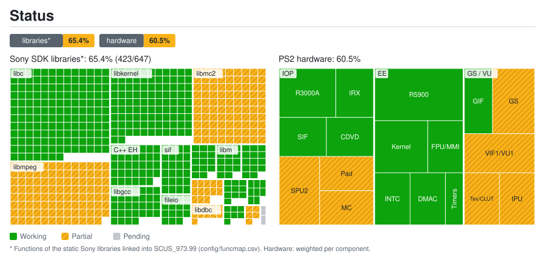

# Port status: details

Generated by `tools/estado/generar.py` from `docs/estado/datos.toml` and `config/funcmap.csv`. Do not edit by hand.

## Sony SDK libraries*: 65.4% (423/647)

| Library | Functions | Status | Note |
|---|---:|---|---|
| `libmpeg` | 103 | 🔧 Partial | Movies through native libmpeg2 with sound: 61 of 67 correct here; SEMO08 (drift), P04MP05 (stops) and BONUS20 (no audio) fail |
| `libipu` | 5 | 🔧 Partial | sceIpuInit fixed; the software MPEG path works, but full IPU operation coverage is unverified |
| `libgraph` | 7 | ✅ Working |  |
| `libdma` | 8 | ✅ Working |  |
| `libcdvd` | 10 | ✅ Working | Reads the disc files extracted next to the ELF (.disc_layout); the ISO only with GOW_ISO |
| `libdbc` | 11 | 🔧 Partial | Native controller and card services instead of the emulated SIO2 |
| `libpad2` | 13 | 🔧 Partial | Native controller service (keyboard and gamepad); pressures 0/255 |
| `libvib` | 2 | ⏳ Pending | Native rumble from the Waffle565 runtime (XInput, DualShock 4/DualSense); not verified here |
| `libmc2` | 90 | 🔧 Partial | Native memory card service (no SIO2); Waffle565 verified loading and saving; not repeated here after the migration |
| `libscf` | 14 | ✅ Working |  |
| `libgcc` | 32 | ✅ Working |  |
| `C++ EH` | 34 | ✅ Working |  |
| `libm` | 14 | ✅ Working |  |
| `libc` | 150 | ✅ Working |  |
| `libkernel` | 101 | ✅ Working |  |
| `sif` | 24 | ✅ Working | SIF commands and RPC |
| `fileio` | 15 | ✅ Working |  |
| `loadfile` | 14 | ✅ Working | IOP heap and module loading |

## PS2 hardware: 60.5%

| Group | Component | Weight | Status | Note |
|---|---|---:|---|---|
| EE | R5900 CPU (recompiled to C++) | 5 | ✅ Working |  |
| EE | Kernel: threads, semaphores and alarms | 3 | ✅ Working |  |
| EE | FPU (COP1) and MMI instructions | 2 | ✅ Working |  |
| EE | INTC: VSync and GS interrupt | 2 | ✅ Working |  |
| EE | DMA controller | 2 | ✅ Working | Native DMA service: chains go straight to VIF1/VU1 and the GS, with no controller model; reusable buffers |
| EE | Timers | 1 | ✅ Working | Native EE clock: the recompiler turns timer reads into clock calls |
| GS / VU | GS: primitives and framebuffer | 3 | 🔧 Partial | Native OpenGL render-target renderer (Waffle565), 2x internal resolution; menu, ship, combat and HUD correct here, 4 zones at Waffle565; a full playthrough is pending |
| GS / VU | VIF1 and VU1 | 3 | 🔧 Partial | Ahead-of-time native VU1 and fast UNPACK; ship combat with a 16.7 ms median frame (59.94 Hz) and ~2/3 of the frames at 60; spikes remain when VU1 work exceeds ~15 ms |
| GS / VU | GS: textures, CLUT and fonts | 2 | 🔧 Partial | Native texture and CLUT store instead of a VRAM model; HUD and menu fonts correct in the captures |
| GS / VU | GIF (PATH1-3) | 2 | ✅ Working |  |
| GS / VU | IPU: FMV video | 2 | 🔧 Partial | No IPU: the native MPEG decoder takes the data from the PSS; Waffle565 verified every movie with sound |
| IOP | R3000A CPU (IRX compiled to C++) | 3 | ✅ Working | The game's 8 IRX compiled ahead of time (optional, from a dump): gameplay at 21 s instead of 34 s; without a dump, interpreter |
| IOP | SPU2: audio output | 3 | 🔧 Partial | Native sound engine driven by the game's LIBSD calls (Waffle565); a sustained listening check is pending here after the migration |
| IOP | Original IRX modules | 2 | ✅ Working | The original IRX, in the interpreter or compiled to C++ |
| IOP | SIF: EE ↔ IOP RPC and DMA | 2 | ✅ Working |  |
| IOP | CDVD: extracted disc files | 2 | ✅ Working | Each file at its original sector (.disc_layout); the ISO only with GOW_ISO |
| IOP | DualShock 2 controller | 2 | 🔧 Partial | Native controller service (keyboard and gamepad, no SIO2); pressures 0/255 |
| IOP | Memory card | 2 | 🔧 Partial | Native service (no SIO2); Waffle565 verified loading and saving; not repeated here after the migration |

* Functions of the static Sony libraries linked into SCUS_973.99 (config/funcmap.csv). Hardware: weighted per component.
